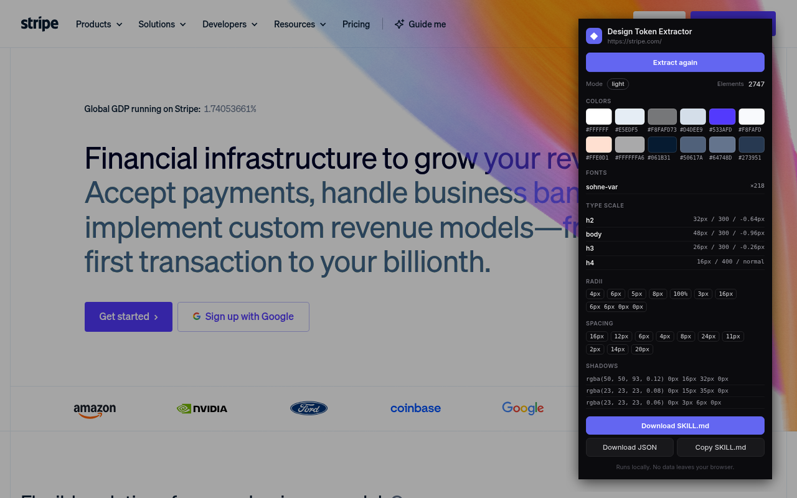

# Design Token Extractor

Turn any website's look into design tokens in one click — then hand them to your AI coding tool.

A tiny Chrome / Edge extension (Manifest V3) that reads the computed styles of the page you're on and exports them as **SKILL.md** (for Cursor, Claude Code, Codex) or **JSON**.

## What it extracts
- **Colors** — canvas, surfaces, text, borders and accent colors, ranked by usage
- **Typography** — font families and the h1–h4 / body / mono type scale (size, weight, letter-spacing)
- **Spacing** scale, flex/grid gaps, **border radii** and **shadows**
- Real **button recipes** (height, padding, radius, colors)
- `:root` **CSS variables** (same-origin stylesheets)

## Export
- **SKILL.md** — drop it into `.cursor/skills`, `CLAUDE.md` or `AGENTS.md` so your AI builds UI in that style
- **JSON** — for your design-token pipeline, Tailwind config or Figma plugin

## Install (Chrome / Edge, manual — about 1 minute)
1. Download **[design-token-extractor-0.1.0.zip](https://github.com/WuDao0123/design-token-extractor/releases/download/v0.1.0/design-token-extractor-0.1.0.zip)** from the [latest release](https://github.com/WuDao0123/design-token-extractor/releases/latest).
2. Unzip it into a folder you'll keep (e.g. `design-token-extractor/`). Don't delete the folder afterwards — the browser loads the extension from it.
3. Open `chrome://extensions` (Edge: `edge://extensions`).
4. Turn on **Developer mode** (top right in Chrome; left sidebar in Edge).
5. Click **Load unpacked** and select the unzipped folder (the one that contains `manifest.json`).
6. Pin the extension, open any website and click the icon → **Download SKILL.md** or **JSON**.

> Alternatively clone this repo and load the `extension/` folder.

## Privacy
Permissions are only `activeTab` + `scripting`: it runs only on the tab where you click the icon. No remote code, no network requests, no analytics, no storage — everything runs locally in your browser.
Full policy: <https://taste-skill.pages.dev/design-token-extractor/privacy/>

## Known limits
- Accent detection is heuristic; monochrome sites may show no accent.
- Cross-origin stylesheets can't be read, so CSS variables only come from same-origin sheets.
- Scans up to 4,000 elements per page.

## More
30 ready-made design systems (Linear, Stripe, Vercel …) as SKILL.md files: **<https://taste-skill.pages.dev>**

## License
[MIT](LICENSE)
